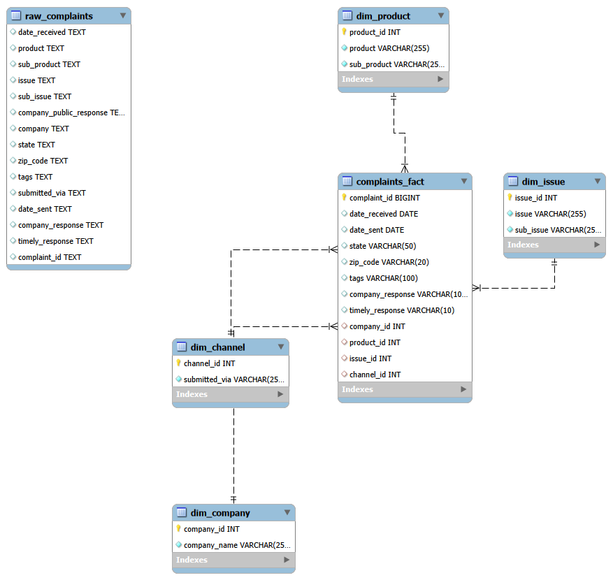

# Channel & Client Insights: Bank of America, Chase, and Wells Fargo Complaint Analysis

An SQL and Tableau portfolio project analyzing consumer complaint patterns across three major U.S. retail banks, built to demonstrate relational database design, SQL analysis, and dashboard storytelling for banking/client insights roles.

---

## Overview

This project analyzes how consumers submit complaints, what issues they raise, and how quickly companies respond, across Bank of America, JPMorgan Chase, and Wells Fargo. The goal was to build an end-to-end analytics pipeline (raw data → relational schema → SQL analysis → interactive dashboard) using real, public data rather than a pre-cleaned Kaggle dataset.

## Data Source

**CFPB Consumer Complaint Database** — a public database maintained by the U.S. Consumer Financial Protection Bureau, containing every qualifying consumer complaint filed against financial companies since 2011.
https://www.consumerfinance.gov/data-research/consumer-complaints/

**Filters applied:**
- Companies: Bank of America, JPMorgan Chase, Wells Fargo
- Products: Credit card, Checking or savings account
- Date range: 12-month window
- Result: ~43,000 complaint records

**Why this dataset:** it's real (not synthetic), directly relevant to the banking industry, includes a genuine channel field (`Submitted via`), and supports a balanced, multi-company comparison rather than a single-company critique.

## Schema Design

Rather than working off the flat CSV export, I designed and built a star schema in MySQL to demonstrate relational modeling and JOIN-based analysis:

- **`complaints_fact`** — one row per complaint, with foreign keys into each dimension
- **`dim_company`** — Bank of America, Chase, Wells Fargo
- **`dim_product`** — Product / Sub-product combinations
- **`dim_issue`** — Issue / Sub-issue combinations
- **`dim_channel`** — Submission channel (Web, Phone, Referral, Postal mail, etc.)

## SQL Analysis

Queries were written in MySQL to explore the data before building the dashboard, covering joins, aggregation, conditional logic, date functions, and window functions:

- Complaint volume by channel, per bank
- Top complaint issues, per bank
- Timely response rate by channel
- Monthly complaint trend, per bank
- Company response outcomes, per bank
- Top 3 issues per bank (using `RANK() OVER (PARTITION BY ...)`)
- Complaint distribution by state

## Dashboard

Built in Tableau Public, the dashboard includes:

1. **Complaint volume by channel** — bar chart comparing channel usage across banks
2. **Top complaint issues by bank** — ranked issue breakdown
3. **Timely response rate by channel** — response performance by submission method
4. **Complaint trends over time** — monthly trend line, all three banks
5. **Complaint distribution by state** — geographic heat map

A company filter lets viewers isolate any single bank or compare all three at once.

## A Note on Using a Competitor Comparison

Complaint volume alone doesn't indicate service quality; it is affected by company size, customer base, and reporting behavior. This dashboard is framed as an industry benchmarking exercise, not a scorecard, and should be read with that context in mind.

**Live Tableau dashboard:** https://public.tableau.com/views/ChannelClientInsightsBankofAmericaJPMorganChaseWellsFargo/Dashboard2?:language=en-US&publish=yes&:sid=&:redirect=auth&:display_count=n&:origin=viz_share_link

## Tools Used

- **MySQL** — data loading, schema design, analysis queries
- **Tableau Public** — dashboard design and visualization

